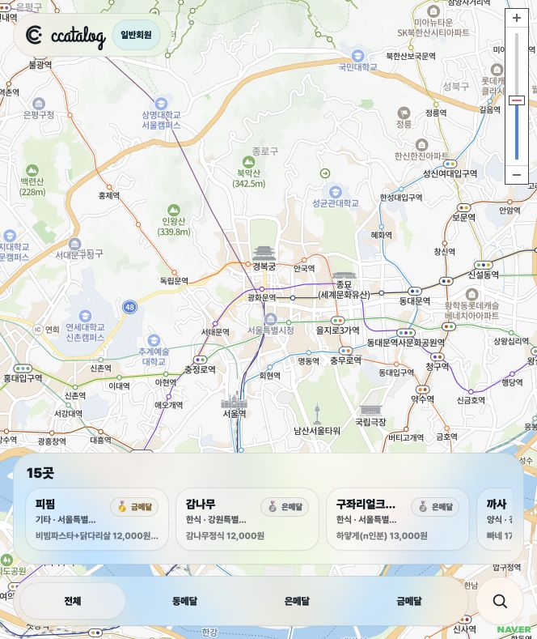
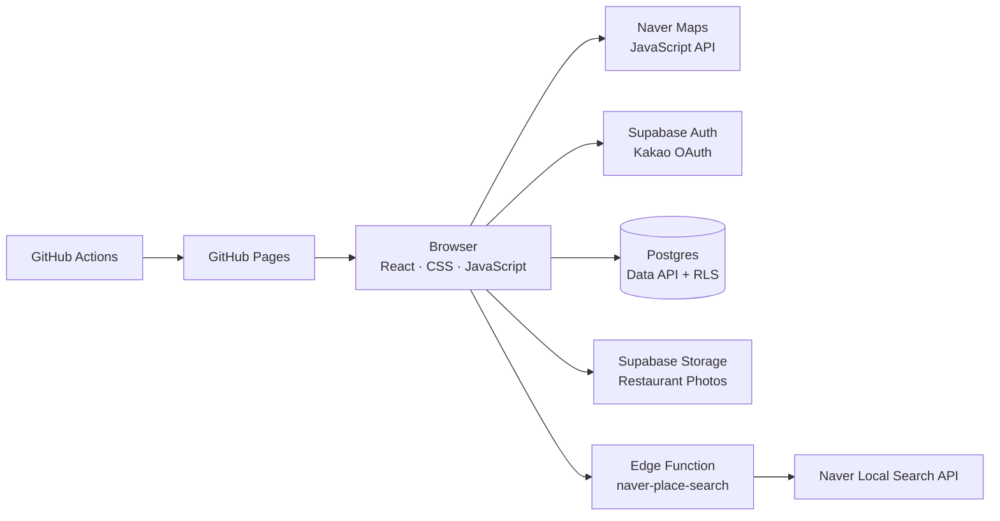

# 까탈로그 (ccatalog)

> 까탈스러운 기준으로 고른 음식점과 추천 메뉴를 기록하는 맛집 로그

[서비스 바로가기](https://mongkwon.github.io/ccatalog/)

## 프로젝트 소개

까탈로그는 **‘까탈스럽다’와 기록을 뜻하는 ‘로그(log)’를 합친 이름**입니다. 각자의 취향으로 고른 음식점과 추천 메뉴를 지도 위에 기록하고, 초대한 사람들과 나눕니다.

회원은 누구나 `까탈리스트`로 참여해 그룹을 만들고, 초대 링크로 사람들을 모을 수 있습니다. 음식점과 사진은 그룹원끼리 공유하며, 등록한 사람이 자신의 기록을 관리합니다. 추천하는 정도를 동메달·은메달·금메달로 표현하고 메뉴별 가격과 배달 가능 앱, 사진을 함께 제공합니다.

## 핵심 기능

- 네이버 지도 기반 맛집 핀, 현재 위치 점 표시, 등록 음식점이 보이도록 자동 줌 조정
- 동메달, 은메달, 금메달 추천 등급과 하단 필터 독
- 추천 메뉴별 가격, 배달의민족·쿠팡이츠·요기요 지원 여부 표시
- Supabase와 카카오 OAuth를 이용한 회원 인증
- 그룹 생성, 초대 링크를 통한 즉시 참여, 그룹별 지도 표시
- 그룹 탈퇴 시 본인의 해당 그룹 기록 삭제, 마지막 그룹원 탈퇴 시 그룹 자동 삭제
- 여러 그룹의 맛집을 한 지도에서 확인하고 그룹별 색상으로 구분
- 같은 장소의 핀을 묶고 그룹별 기록과 메달 확인
- 식당별 공유 주소, 새로고침·뒤로 가기와 로그인 후 상세 복귀
- 작성자 전용 음식점 정보·메뉴·사진 수정 및 삭제
- 그룹원 댓글과 본인 댓글 수정·삭제
- 작성자의 메달 평가와 그룹원의 상승·유지·하락 의견 집계
- 그룹원 전용 음식점 조회와 비공개 사진 저장소
- 첫 방문자에게 서비스 기준을 설명하는 3단계 튜토리얼
- 모바일 Safari와 데스크톱을 함께 고려한 반응형 지도 UI

## 사용자 역할

| 역할 | 권한 |
| --- | --- |
| 비회원 | 로그인 및 초대 참여 안내 |
| 까탈리스트 | 그룹 생성·초대, 가입한 그룹의 음식점 열람·등록 |
| 맛집 작성자 | 자신이 등록한 음식점 정보·메뉴·사진 수정 및 삭제 |

그룹원은 모두 같은 권한으로 참여합니다. 등록자가 메달을 평가하고 수정하며, 다른 그룹원들은 상승·유지·하락 의견을 남깁니다. 메달이 바뀌면 기존 표를 초기화해 새로운 평가에 대한 의견을 받습니다.

## 아키텍처

브라우저 애플리케이션은 React로 구성하고 Vite로 빌드해 GitHub Pages에서 호스팅됩니다. 인증, 데이터베이스, 파일 저장소는 Supabase가 담당하고, 비밀 키가 필요한 네이버 장소 검색만 Edge Function을 통과합니다.

## 기술 스택

- Frontend: React, JavaScript, CSS3, Vite
- Map: Naver Maps JavaScript API
- Backend as a Service: Supabase Auth, Postgres, Data API, Storage, Edge Functions
- Authentication: Kakao OAuth through Supabase
- Deployment: GitHub Actions, GitHub Pages
- Test: Node.js Test Runner, Playwright (Chromium, Mobile WebKit)
